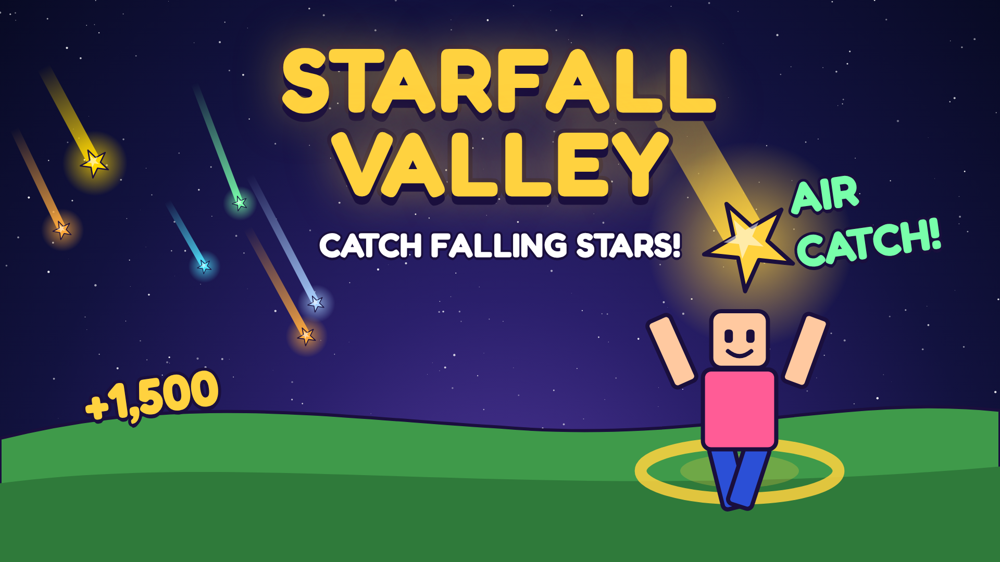

# Starfall Valley

An original Roblox game built from [the playbook](../PLAYBOOK.md). Stars fall from the night sky. Run under them to catch them, jump to grab them mid-air for 1.5x, chain catches into combos, spend Stardust on upgrades, open new zones full of rarer stars, then go **Supernova** for a permanent boost.



## Put it in the place you have open (1 minute)
1. Download **[`Install-Starfall-Valley.lua`](Install-Starfall-Valley.lua)**.
2. In Roblox Studio, with your place open, run it one of two ways:
   - **Model tab → Run Script**, then pick the file; or
   - **View tab → Command Bar**: open the file in any text editor, copy all of it, paste it into the Command Bar, and press Enter.
3. The Output window says **"Installed 30 scripts"**, and the world appears: four zones, gates, signs and a night sky.
4. Press **Play** (F5).

The installer only adds its own scripts. If your place already has something with the same name, it renames yours to `..._Backup` instead of deleting it. Running it again just updates the game, and **Ctrl+Z** undoes it. It replaces the default Baseplate with the valley.

**Or open it as a new place:** download [`Starfall-Valley.rbxlx`](Starfall-Valley.rbxlx), open it with File → Open from File, and press Play.

That's it. The world, UI, sounds and lights are all built by the scripts, so there's nothing to set up. In Studio, saving is off until you turn on API access (step 2 below), and the HUD will say "Studio: not saving".

**Test on a phone layout:** in Studio, open the Test tab → Device, pick a phone, and play. About 80% of Roblox players are on mobile.

## Publish it
1. **File → Publish to Roblox**, then name it.
2. **Turn on saving:** Home → Game Settings → Security → *Enable Studio Access to API Services*. Live servers always save.
3. **Upload the icon and a thumbnail** from [`marketing/`](marketing/) in the Creator Dashboard. Upload **both** thumbnails and turn on thumbnail A/B testing (Roblox reports +8.5% play-through on average).
4. **Optional: money.** In the Creator Dashboard → your experience → Monetization, create the passes and products listed below. Paste each ID into [`src/shared/Config.luau`](src/shared/Config.luau) (`Config.GamePasses` / `Config.DevProducts`), then rebuild or edit the script in Studio. Anything left at ID 0 stays hidden from the shop.
5. **Optional: badges.** Create them and paste the IDs into `Config.Badges`.

| Type | Name | Suggested price | What it does |
|---|---|---|---|
| Pass | 2x Stardust | 199 | Double Stardust forever |
| Pass | Star Magnet | 149 | +50% catch radius |
| Pass | Lucky Charm | 249 | Rarer stars. Luck is shared, so it helps everyone in your zone |
| Pass | Comet Trail | 79 | Rainbow trail and ★ name tag (looks only) |
| Product | Call a Meteor Shower | 49 | Starts a shower **for the whole server** |
| Product | 2x Boost (30 min) | 39 | Timed double Stardust |
| Product | Stardust Pouch | 25 | 15 minutes of earnings |
| Product | Stardust Chest | 99 | 90 minutes of earnings |

No loot boxes, no fake timers, and you can finish everything for free. See playbook #14 for why.

## What's in it

| Feature | Where | Playbook |
|---|---|---|
| Falling stars with landing rings, air catches, combos | `server/Stars.luau`, `client/StarRenderer.luau` | #2 |
| Juice: bursts, pop-up numbers, rising-pitch pings, camera kick on rare catches | `client/Effects.luau` | #3 |
| 4 zones with see-through gates, per-player unlocks | `server/Map.luau`, `server/Progression.luau`, `client/Gates.luau` | #4, #5 |
| 4 upgrades (net, speed, jump, luck), Supernova rebirth | `server/Progression.luau`, `shared/Formulas.luau` | #4, #6 |
| Star Book collection (9 stars, one event-only) | `client/Panels.luau` | #7 |
| Friends bonus, Invite button, shared luck, shout-outs, all-time leaderboard | `server/Economy.luau`, `client/Hud.luau`, `server/Leaderboard.luau` | #8 |
| Meteor Shower every 8 minutes | `server/Events.luau` | #9 |
| Daily rewards (streak pauses, never resets), 3 daily quests, welcome-back gift | `server/Rewards.luau` | #10 |
| Mobile-first HUD with safe-area insets, a compact layout on phones that keeps the jump and thumbstick zones clear, and a NEXT GOAL bar | `client/Hud.luau`, `client/init.client.luau` | #1, #5, #11 |
| One-line-at-a-time tutorial | `client/Tutorial.luau` | #1 |
| Cartoony UI kit (one font, fixed color meanings, button feedback) | `client/Theme.luau` | #12 |
| Onboarding funnel and economy analytics | `server/Analytics.luau` | #13 |
| Safe purchases (saved before they're confirmed), live prices | `server/Shop.luau`, `client/Panels.luau` | #14 |
| Saving with a session lock (server hops never lose progress), retries, autosave, shutdown save | `server/DataService.luau` | (needed) |

**Tune anything** (star values, zone costs, spawn rates, rewards, event timing) in [`src/shared/Config.luau`](src/shared/Config.luau). Every number is there, with a comment saying what it's for.

## Work on the code
The scripts are plain `.luau` files laid out for [Rojo](https://rojo.space), the standard way to keep Roblox code in files and git.

```bash
rojo serve                                   # live-sync into Studio (install the Rojo plugin)
rojo build -o Starfall-Valley.rbxlx          # rebuild the place file
python3 tools/make_installer.py              # rebuild Install-Starfall-Valley.lua
selene src tests                             # lint (first run downloads the Roblox API list)
stylua src tests                             # format
lune run tests/run.luau                      # unit tests for the game math
lune run tests/installer.luau                # checks the installer rebuilds src/ exactly
```

Checks that passed before this was committed:
- Every file compiles with the Luau compiler.
- Selene with the full Roblox API: 0 errors, 0 warnings.
- 700 property and method uses checked against Roblox's API dump: 0 problems.
- 21 unit tests on prices, pacing, odds, rewards and quests: all passing.
- The installer, run against a pretend place, puts all 30 scripts in the same spots as Rojo's build with byte-identical code. Re-running it is safe, and existing scripts are kept as backups.
- An independent code review found no runtime errors; its 9 fixes are in. They cover the phone layout clearing the jump button, anti-teleport-farming, culling far stars, the save lock, a two-tap Supernova confirm, and more.

It has not been play-tested in Roblox Studio yet (it was built on a server without Studio), so press Play and tell Claude about anything that looks off.

## What to add next
Small updates every 2–4 weeks keep players coming back (playbook #7). In rough order of value for effort:
1. **A 5th zone** and two new stars. Add them to `Config.Zones` and `Config.Stars`, and the map builds itself.
2. **Weekend events**: double Novas, or a "Golden Hour" where all stars are Gold or better.
3. **Pets that orbit you** and slightly widen your net. Sell them for Stardust only, never as random paid eggs.
4. **Trading Star Book duplicates** for cosmetic trails (social glue).
5. **Opt-in notifications** ("Meteor Shower in 5 minutes") through Roblox's Experience Notifications, max one a day.
6. **Replace the generated scenery** with your own builds. Keep the zone spacing and the `Gate_<n>` names.
